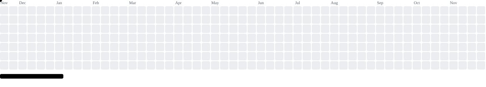

**Incoming Ph.D. student, Mechanical Engineering, McGill University** · M.A.Sc. Concordia University

I build simulations of compressible, multiphase and reacting flows, and use machine learning to make them faster.

## About

- **Ph.D., McGill University** (from January 2027), ASEC Lab with Prof. Hendrik Nicolai: DNS/LES of hydrogen–methane flames.
- **M.A.Sc., Concordia University** (2023–2026), with Prof. Moussa Tembely: thermofluid simulation of thermal spray processes. GPA 4.23/4.3, thesis graded *Outstanding*.
- Mesh-based graph neural networks that run thermal Homann flow simulations about 100× faster than the CFD solver ([IEEE Access, 2025](https://ieeexplore.ieee.org/document/11025840)).
- RANS → DDES and aeroacoustic simulations of supersonic jets on Compute Canada clusters (400+ cores).
- **CFD Team Lead, Space Concordia Rocketry** (since December 2024): aerodynamics of the CR25 and CR26 high-power rockets.
- **L3-certified rocketeer**, Canadian Association of Rocketry.

## Featured projects

<table>
<tr>
<td width="50%" valign="top">

<h3><a href="https://github.com/DaraSamii/SpaceConcordia-CR26">SpaceConcordia-CR26</a></h3>
CFD (OpenFOAM, cfMesh), structural loads and flight telemetry analysis of Space Concordia's two-stage CR26 rocket.
  <b>OpenFOAM · cfMesh · Python · Jupyter</b>
</td>
<td width="50%" valign="top">

<h3><a href="https://github.com/DaraSamii/SpaceConcordi-CR25">SpaceConcordia-CR25</a></h3>
Aerodynamic forces on the CR25 airframe, with its unusual transition section, across Mach numbers and angles of attack.
  <b>OpenFOAM · Python · Jupyter</b>
</td>
</tr>
<tr>
<td width="50%" valign="top">

<h3><a href="https://github.com/DaraSamii/sonicDPMFoam">sonicDPMFoam</a></h3>
OpenFOAM solver for transonic and supersonic compressible flow with Lagrangian particles (sonicFoam + DPM).
  <b>C++ · OpenFOAM</b>
</td>
<td width="50%" valign="top">

<h3><a href="https://github.com/DaraSamii/MeshGraphNet_Homann_results">MeshGraphNet · Homann flow</a></h3>
Results of the IEEE Access paper: a mesh-based graph neural network that predicts thermal Homann flow fields.
  <b>PyTorch · PyTorch Geometric · OpenFOAM</b>
</td>
</tr>
</table>

<b>Desktop tools I built for KDE Plasma 6</b>

 
<table>
<tr>
<td width="50%" valign="top">

<b><a href="https://github.com/DaraSamii/DaraLauncher">DaraLauncher</a></b> 
Full-screen application launcher with favorites, A–Z sections, categories and calculator search.
</td>
<td width="50%" valign="top">

<b><a href="https://github.com/DaraSamii/DaraPlasmoids">DaraPlasmoids</a></b> 
Plasma widgets, including a multi-city animated weather widget with hourly and 7-day forecasts.
</td>
</tr>
</table>

## Publications

| Year | Title | Venue |
|:----:|-------|-------|
| 2026 | [Investigation of Aeroacoustics and In-flight Particle Transport in Thermal Spray Supersonic Jets](https://doi.org/10.48550/arXiv.2603.05547) | arXiv preprint |
| 2025 | [Accelerating Thermal Homann Flow Simulation With Mesh-Based Graph Neural Networks](https://ieeexplore.ieee.org/document/11025840) | IEEE Access |
| 2023 | [CFD Based Design Gas Rotameters: Dynamic Mesh Transient Simulation](https://doi.org/10.1016/j.flowmeasinst.2023.102513) | Flow Measurement and Instrumentation |

## Honors

- Teaching Excellence Award for Teaching Assistants, Concordia University (2026)
- Mitacs Globalink Research Award, CAD 6,000, France–Canada collaboration (2025)
- Concordia Merit Scholarship, CAD 5,000 (2023)
- 8th place, 27th National Chemical Engineering Olympiad, Iran (2022)
- 1st place (team lead), "Rahneshan" National Competition, CFD of particle crystallization and growth (2021)

## Tools

| | |
|---|---|
| **CFD & simulation** | OpenFOAM (custom solvers) · ANSYS Fluent · COMSOL · ParaView · PyVista |
| **CAD & meshing** | SpaceClaim · FreeCAD · Salome · Onshape · SolidWorks |
| **Programming** | Python (NumPy, SciPy, Pandas) · C/C++ · MATLAB · Bash |
| **Machine learning** | PyTorch · PyTorch Geometric · scikit-learn · Optuna |
| **HPC & tooling** | Slurm · Linux · Git · Docker · LaTeX |

Languages: English (professional, IELTS 7.5) · French (B1) · Persian (native)

## Commit arcade

<!-- ARCADE:START -->

<picture>
  <source media="(prefers-color-scheme: dark)" srcset="https://raw.githubusercontent.com/DaraSamii/DaraSamii/output/breakout-contribution-graph-dark.svg">
  <source media="(prefers-color-scheme: light)" srcset="https://raw.githubusercontent.com/DaraSamii/DaraSamii/output/breakout-contribution-graph.svg">
  
</picture>

My last year of commits as Breakout bricks, regenerated daily with <a href="https://github.com/abozanona/pacman-contribution-graph">pacman-contribution-graph</a>.

<!-- ARCADE:END -->

